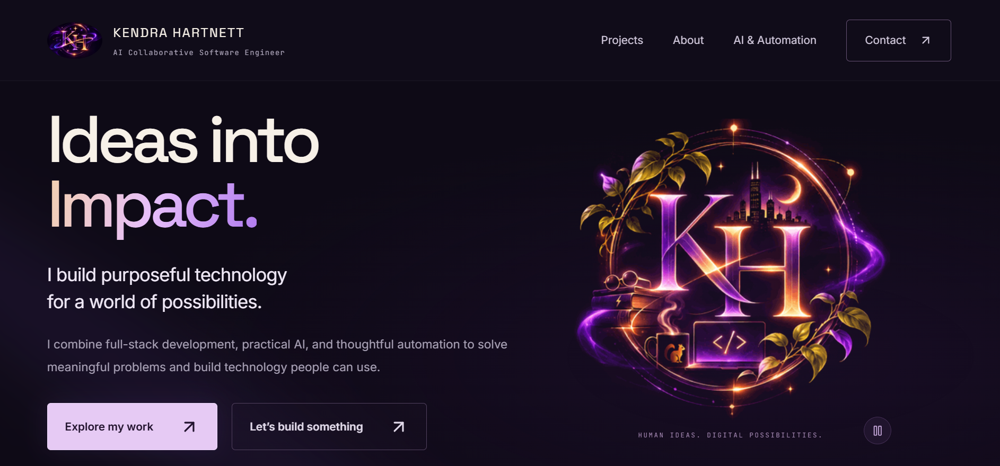

# Kendra Hartnett — Portfolio



A personal portfolio for Kendra Hartnett, an AI Collaborative Software Engineer. It presents selected application and product work, an approach to practical and responsible AI, and the thinking behind the work.

**Domain:** [www.kendrahartnett.com](https://www.kendrahartnett.com) — connection in progress.

## Features

- Responsive pages for the home, projects, About, AI and automation, and contact sections.
- Project cards and individual case-study pages for EEVORA, The Bridge, GoodNeighbor, and Ethical Apple.
- An animated KH hero using Kendra's supplied artwork, with scroll reveals and reduced-motion support.
- A responsible AI section covering guardrails, safe fallbacks, human review, security, privacy, and failure-case evaluation.
- Static export, sitemap, robots metadata, and an export check for routes, links, and assets.

## About me

I'm a Full-Stack Developer and AI-Augmented Builder who enjoys bringing ideas to life through technology. I approach development through both an engineering and creative lens, with care for intuitive experiences and solutions that serve a purpose.

My path into technology hasn't been traditional. A second chance to pursue something new has shaped how I approach challenges: with curiosity, resourcefulness, adaptability, and a willingness to think differently.

**I think critically. I create boldly. I build purposefully.**

## Built with

Next.js App Router, React, TypeScript, and Tailwind CSS. The interface also uses GSAP, Motion, an Aceternity UI Spotlight component, and a Magic UI Border Beam component. Fonts are bundled locally. See [third-party notices](THIRD_PARTY_NOTICES.md) for component origins.

## Run locally

```bash
npm ci
npm run dev
```

Open `http://127.0.0.1:3000`. For a production build and local preview:

```bash
npm run typecheck
npm run build
npm run check:export
npm start
```

The static site is written to `out/`; `npm start` serves the export at `http://127.0.0.1:3107`. Set `NEXT_PUBLIC_SITE_URL` to the final deployment origin before building so the sitemap and social metadata use the correct URL. No database or API credentials are required for this portfolio. Contact links lead to the EEVORA contact page; the portfolio does not collect form submissions.

Project content is maintained in [`src/lib/projects.ts`](src/lib/projects.ts). [Content verification](docs/CONTENT_VERIFICATION.md) records the evidence and limits behind project descriptions, and [verification notes](docs/VERIFICATION.md) explain the build checks.

## Author

**Kendra Hartnett** · [LinkedIn](https://www.linkedin.com/in/kendra-hartnett-7877ab422/) · [GitHub](https://github.com/kendrahartnett)
